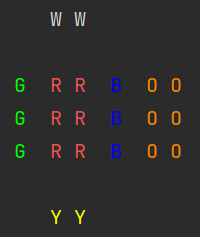
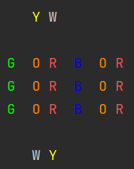
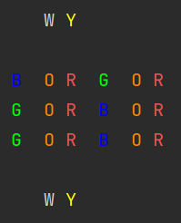
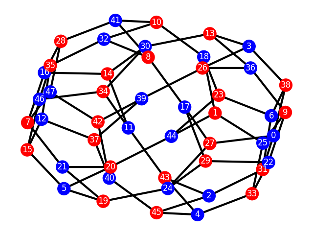

# Rubiks-Cube

A lightweight Python library that implements a representation of a Rubik's Cube for research and simulation purposes. This library allows you to create cubes of various dimensions, apply movements, and even analyze the state space using graph theory.

## Features

- **Arbitrary Dimensions**: Create cubes of dimensions $(N_x, N_y, N_z)$ (e.g., 3x3x3, 2x2x2, 3x2x1).
- **Move Validation**: Strictly validates movements based on permitted operations.
- **Immutable State**: `RubikCube` instances are immutable and hashable, making them suitable for state-space search algorithms and graph analysis.
- **Graph Analysis**: Built-in tools to generate and visualize the state graph for a given set of allowed movements.

## Installation

You can install the package directly from the source:

```bash
pip install .
```

Or recursively with the dependencies:

```bash
pip install -r requirements.txt
```

## Usage

### 1. Creating a Rubik's Cube

The easiest way to create a Rubik's Cube is using the `RubikCube.from_dims` factory method.

```python
from rubiks_cube.cube import RubikCube

# Create a 3x2x1 cube
rc = RubikCube.from_dims((3, 2, 1))
print(rc)
```

**Output Representation:**



### 2. Making Movements

You can apply movements to the cube. Since `RubikCube` is immutable, applying a move returns a **new** instance.

#### Single Move
Use `CubeMove` enums for type safety.

```python
from rubiks_cube.cube import RubikCube
from rubiks_cube.movements import CubeMove

rc = RubikCube.from_dims((3, 2, 1))
# Apply L2 (Left face, 180 degrees)
rc = rc.make_movements(CubeMove.L2)
print(rc)
```



#### Sequence of Moves
Pass a list of `CubeMove` or a space-separated string.

```python
# Using a list of CubeMove
rc = rc.make_movements([CubeMove.L2, CubeMove.U2])

# Using a string notation
rc = rc.make_movements("L2 U2")
print(rc)
```



### 3. Graph Theory Analysis

You can generate a graph where nodes are Rubik's Cube states and edges represent permitted movements. This is useful for analyzing the group structure or finding algorithms.

Given a set of permitted movements $M = \{U^2, R^2, D^2\}$ (operations over the group of Rubik's Cube), we can create a graph $G_M=(V, E_M)$ where:

- $V = \{ r \mid r \text{ is a Rubik's Cube reachable state} \}$
- $E_M = \{ (r, t) \in V \times V \mid t = m(r), m \in M \}$

```python
from matplotlib import pyplot as plt

from rubiks_cube.graph import make_graph
from rubiks_cube.movements import CubeMove as CM
from rubiks_cube.plotters import GraphPlotter

# Generate the graph for a 3x2x1 cube with only double moves allowed on R, D, U
g = make_graph(
    dims=(3, 2, 1),
    permitted_movements={CM.R2, CM.D2, CM.U2}
)

# Visualize the graph
gp = GraphPlotter(g)
gp.compute_kamada_kawai_layout()
gp.find_bipartite()
gp.draw()
plt.show()
```

**Generated Graph:**



## License

This project is licensed under the MIT License.
